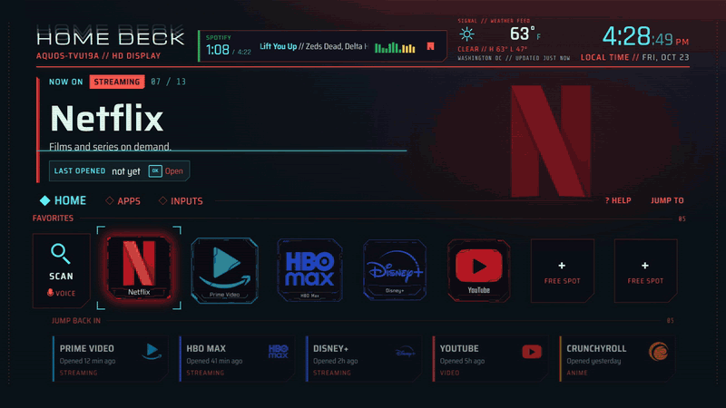
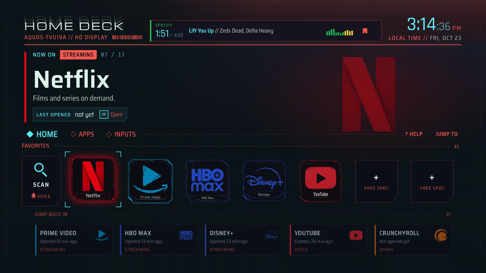
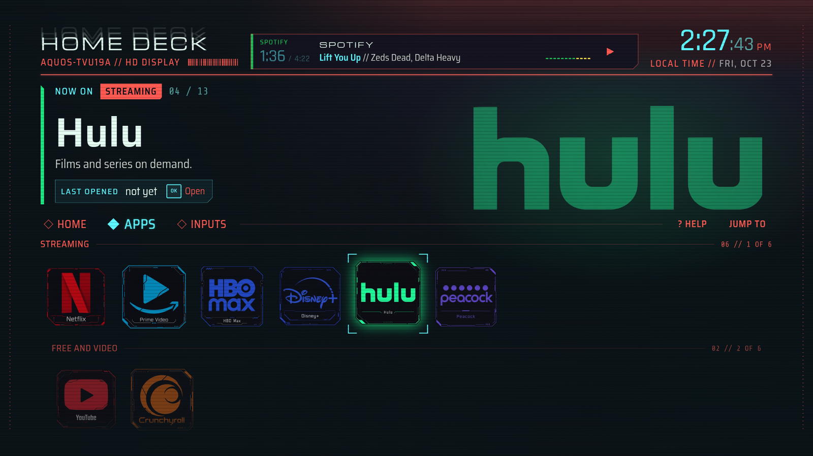
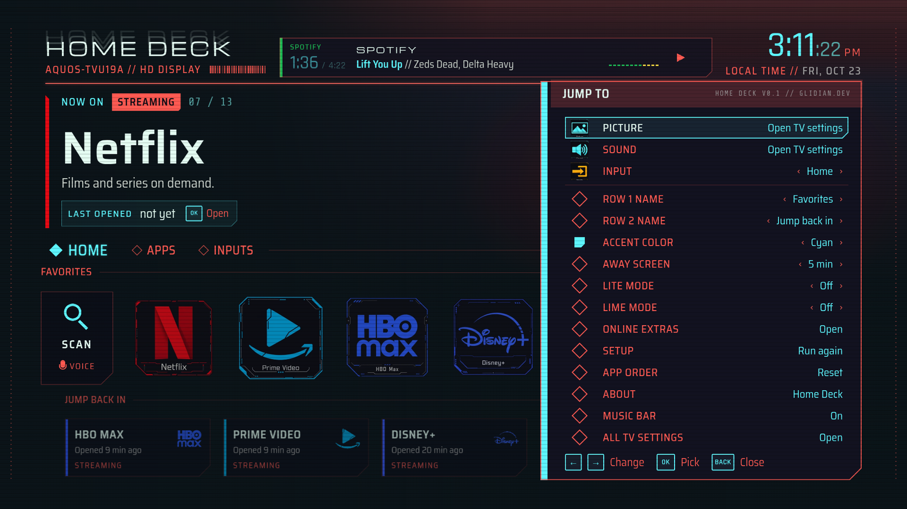
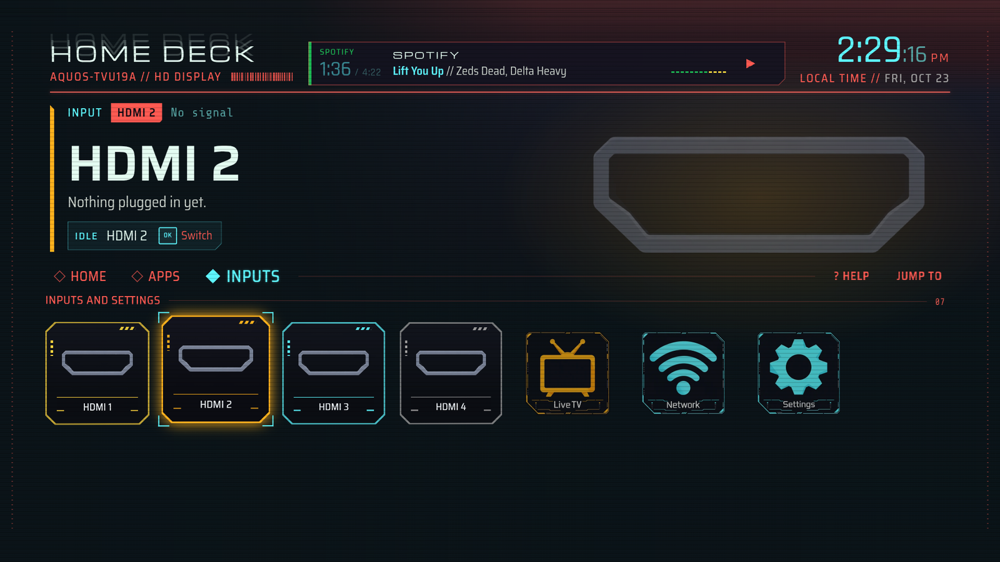

# Home Deck

A neon home screen for Android TV. Your apps as big glowing tiles, the art of whatever you're on filling the
background, a music bar that shows what's actually playing, and your HDMI inputs named after the devices on them.
No ads, no rows of recommendations, and it works offline.

[](docs/home-deck-demo.mp4)

A 45-second tour of the favorites, Apps, moving an app, Inputs and Jump To: [watch the video](docs/home-deck-demo.mp4).
I rendered it on a PC at 60 fps. On a TV it runs a little less smoothly, depending on the hardware (my Sharp manages
about 46 to 48 fps).



**Android TV 8.0+ · offline by default · free and open source (MIT)**

> [!NOTE]
> Home Deck is fan-made and free. App names and logos belong to their owners. It isn't affiliated with or
> endorsed by any of them.

## What's on screen

- **Home.** Search, up to seven favorites, and **Jump back in**: the apps you opened last, newest first. When
  something on HDMI is live (a console you just turned on, say), it leads that row, and OK switches to it.
- **Apps.** Everything on your TV, grouped by kind (Streaming, Free and video, Live TV and sport, Music and
  radio, Kids, Games, Your media, Tools and more).
- **Inputs.** Your HDMI ports, Live TV, Network and Settings.
- **The big readout.** Move to anything and its name, what it is and what you'd do there show at the top, with
  its art fading in behind.
- **Music bar.** What's playing, the artist, the track time, and play/pause. Long titles scroll like a car stereo.
- **Jump To.** Hold Back anywhere for the quick panel: the TV's picture and sound settings, inputs, the names of
  the two rows, an accent color that tints everything, how soon the away screen comes on, Lite mode, Lime mode (a lime-on-teal look), online extras,
  setup, app order and About.
- **Away screen.** After 5 minutes of nothing, the screen dims to a clock that moves every 20 seconds, so nothing
  burns in. Pick 1, 3, 5 or 10 minutes in Jump To.
- **Screen saver.** The same away screen as your TV's screen saver, for when you're in another app. See
  [Screen saver](#screen-saver).
- **First-run setup.** Pick your favorites, a color and names for your inputs. Skip it if you like; it's in Jump To
  later.



## Your apps

Popular apps (Netflix, Prime Video, HBO Max, Disney+, YouTube, Hulu, Peacock, Crunchyroll, Spotify, Apple TV,
Paramount+, Plex, Pluto TV, Tubi, Twitch, Sling, YouTube TV, ESPN, Kodi, Jellyfin, VLC and more) get their own
tile art. Anything else gets a badge made from its own icon, framed in the icon's main color.

The manuals, updaters, store demos and setup apps that come with a lot of TVs are left out. They're still installed;
Home Deck just doesn't show them.

Install or remove an app and Home Deck updates itself.

## Using it

| Remote | What it does |
|---|---|
| Arrows | Move around. Going past the end of a row carries on to the next one, and on to the next section. |
| OK | Open |
| Hold OK | Options: open, pin to favorites, move, info, uninstall (on inputs: switch, name, audio out) |
| Back | Climb back up: to the first row, then the section's tab, then Home |
| Hold Back | Jump To |
| Play/pause | Play or pause whatever's in the music bar |

On some remotes the button that takes you Home has a different name. On Sharp TVs, for example, it's the Apps button.

### Moving apps

Hold OK on an app and pick **Move**. It lifts, and Left and Right slide it along the row (Up and Down move it
between lines in a big group). OK drops it there, Back puts it back. Favorites can be reordered freely, empty spots
included. In Apps you can reorder inside each group, and new apps you install land at the end of their group.
**Jump To > App order** puts everything back the way it was.



## Music bar (optional)

While something plays, the bar at the top shows the app, the track, the artist and the time, with a play/pause
button. Android only lets an app see that through notification access, so Home Deck asks for it, but it never reads
your notifications. It only looks at what's playing.

Turn it on in **Jump To > Music bar**. If your TV doesn't have a screen for notification access (a lot of them
don't), turn it on with adb instead:

```bash
adb shell cmd notification allow_listener dev.glidian.homedeck/dev.glidian.homedeck.NowPlayingListener
```

To turn it off again, use `disallow_listener` with the same name.

## Inputs

Each HDMI port shows the name the device on it gives over HDMI-CEC (a console or a player), or the name you gave the
port in the TV's settings. You can also pick a name yourself: hold OK on the port. A port your soundbar uses for
sound (HDMI ARC) can be marked as audio out, so it's never offered as something to watch. When something starts
sending a signal, a small "incoming" card offers to switch to it.

**Live TV** opens your TV's own live TV app. Without an antenna or cable plugged in, that app shows whatever input it
used last, so you might just see "no signal" there.



## Screen saver

Home Deck also adds its away screen to Android's screen savers: the dim clock and the date, moving every 20 seconds.
If the weather is on in Home Deck, it shows that too. Any button wakes the TV, and the TV still goes to sleep on its
own timer.

Pick **Home Deck** in Settings > Device Preferences > Screen saver. If your TV hides that menu, use adb:

```bash
adb shell settings put secure screensaver_components dev.glidian.homedeck/dev.glidian.homedeck.ScreenSaver
```

To go back, pick another screen saver in the same menu, or list what your TV has and set that one the same way:

```bash
adb shell cmd package query-services -a android.service.dreams.DreamService --brief
```

## Online extras

Everything works offline. The extras only connect when you switch them on, in **Jump To > Online extras**.

- **Weather.** A small readout beside the clock, from [Open-Meteo](https://open-meteo.com) (free, no account).
  Pick a city from the list or type one. It updates every 30 minutes and keeps the last reading when you're offline.

That's the only reason Home Deck has the internet permission. With the extras off, it doesn't connect to anything.

## What Android doesn't let a home screen do

Home Deck is installed like any other app, so a few things stay off limits:

- **Shows and episodes from other apps.** "Continue watching" rows come from a permission only the TV's built-in
  launcher gets, so Jump back in lists apps instead.
- **Picture mode, sound output and the sleep timer.** There's no way for an app to change them, so Jump To opens the
  TV's own picture and sound settings instead.
- **The signal format** (resolution, HDR, frame rate) of an input isn't shared with apps.
- **"Is something plugged in?"** Some TVs report every HDMI port the same way, so the live tile and the incoming
  card only show up when the TV says a port is connected or a device announces itself.
- **Voice search** isn't built yet.

## Install

Home Deck isn't on the Play Store; you install it yourself with adb. You'll need a computer with
[adb](https://developer.android.com/tools/releases/platform-tools) on the same network as the TV.

1. On the TV, turn on Developer options (Settings > Device Preferences > About, press OK on **Build** seven times),
   then turn on **USB debugging** or **Network debugging** in Developer options.
2. Find the TV's IP address (Settings > Network) and connect:
   ```bash
   adb connect 192.168.1.50:5555
   ```
   Accept the prompt on the TV.
3. Download `homedeck.apk` from [Releases](../../releases) and install it:
   ```bash
   adb install homedeck.apk
   ```
   Updating works the same way: `adb install -r homedeck.apk` keeps your favorites and settings.

Home Deck now shows up in your apps. To make it what the Home button opens:

```bash
adb shell cmd package set-home-activity dev.glidian.homedeck/.HomeActivity
```

Some TVs keep sending Home to the stock launcher anyway. If yours does, switch the stock launcher off (this doesn't
uninstall anything):

```bash
# Android TV
adb shell pm disable-user --user 0 com.google.android.tvlauncher
# Google TV
adb shell pm disable-user --user 0 com.google.android.apps.tv.launcherx
```

> [!IMPORTANT]
> If you switch the stock launcher off, turn it back on **before** you ever remove Home Deck. See
> [Uninstall](#uninstall).

> [!TIP]
> Installing another app that can be a home screen can make the TV forget your choice. If Home stops opening Home
> Deck, run the `set-home-activity` command again.

### Switching back

To go back to your old home screen, point Home at it again. This lists the home screens on your TV:

```bash
adb shell cmd package query-activities --brief -a android.intent.action.MAIN -c android.intent.category.HOME
```

Then give Home the one you want, exactly as the list shows it:

```bash
adb shell cmd package set-home-activity <name from the list>
```

Some TVs also have Android's home app chooser, hidden from their Settings menu:

```bash
adb shell am start -a android.settings.HOME_SETTINGS
```

## Uninstall

> [!WARNING]
> If you switched the stock launcher off, turn it back on **first**. Otherwise the TV has nothing to show when you
> press Home.

```bash
# Android TV
adb shell pm enable com.google.android.tvlauncher
# Google TV
adb shell pm enable com.google.android.apps.tv.launcherx
```

Then remove Home Deck:

```bash
adb shell cmd notification disallow_listener dev.glidian.homedeck/dev.glidian.homedeck.NowPlayingListener
adb uninstall dev.glidian.homedeck
```

## Privacy

- Your favorites, app order, names, color and settings stay on the TV.
- Jump back in only knows about apps you opened from Home Deck. Nothing is sent anywhere.
- The music bar reads the title, artist, app, time and play state of what's playing, and nothing else. It never
  looks at your notifications.
- The internet permission is only for the online extras, and they're off until you turn them on.
- It also asks for `ACCESS_NETWORK_STATE` and `ACCESS_WIFI_STATE` (for the Network tile), and
  `REQUEST_DELETE_PACKAGES` (so Uninstall can open Android's own confirmation).

## Smooth on slow TVs

TVs have small graphics chips, so Home Deck draws the way they like it: the full-screen backdrop is drawn once and
kept, only transforms and fades animate, and moves settle on a soft decelerating curve. If your TV is still slow,
**Lite mode** (Jump To) drops the glows, the haze and the scanlines. Home Deck also switches to Lite by itself if the
first seconds after it starts run slow.

## Tested on

| TV | Android | Notes |
|---|---|---|
| Sharp AQUOS 4K | Android TV 11 | Mali-470 graphics, 1.4 GB memory. About 46 to 48 fps moving around with the full look, 51 in Lite mode. Tested with its remote: launching apps, holding OK for options, moving apps, HDMI switching, Live TV, uninstalling, and coming back on Home Deck after a reboot |

If something looks off on your TV, please open an issue.

## Build from source

You'll need JDK 17 and the Android SDK (API 34).

```bash
./gradlew assembleDebug
adb install -r app/build/outputs/apk/debug/app-debug.apk
```

The app is a small Java shell around a web page. The page, its interface kit, the fonts and the tile art are in
`app/src/main/assets/www/`, and the Java side (`Bridge.java`) answers the page's questions about the TV: the apps,
what's playing, the inputs and the settings screens. You can try the page in a desktop browser too, with sample apps
and inputs (arrow keys are the remote, Enter is OK, Escape is Back):

```bash
cd app/src/main/assets/www
python -m http.server 8000
```

Then open `http://localhost:8000/?nosetup`.

Don't want the tile art? It's in `app/src/main/assets/www/icons/`. Delete an app's files there (for example
`netflix.webp` and `netflix-bg.webp`) and Home Deck shows that app's own icon in a badge instead.

`tools/speedtest.mjs` measures how smoothly a debug build draws on your TV while it presses the D-pad over adb, and
`tools/banner.html` is the source of the launcher banner.

## Credits

- Fonts, all under the SIL Open Font License: [Michroma](https://fonts.google.com/specimen/Michroma),
  [Rajdhani](https://fonts.google.com/specimen/Rajdhani), [Saira](https://fonts.google.com/specimen/Saira) and
  [Share Tech Mono](https://fonts.google.com/specimen/Share+Tech+Mono).
- Weather from [Open-Meteo](https://open-meteo.com).
- Made by Glidian. More projects at [glidian.dev](https://glidian.dev).

The app tiles are fan art of each app's logo. App names and logos belong to their owners; Home Deck isn't
affiliated with or endorsed by any of them.

## License

MIT. See [LICENSE](LICENSE).

---

Made by [Glidian](https://glidian.dev).
